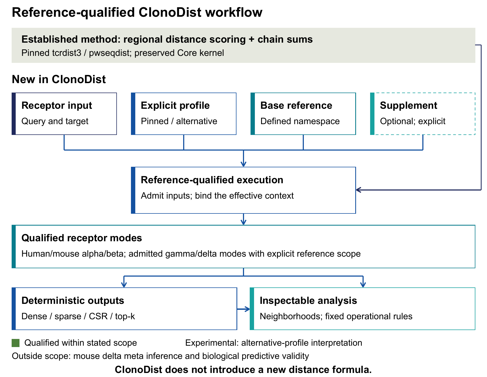
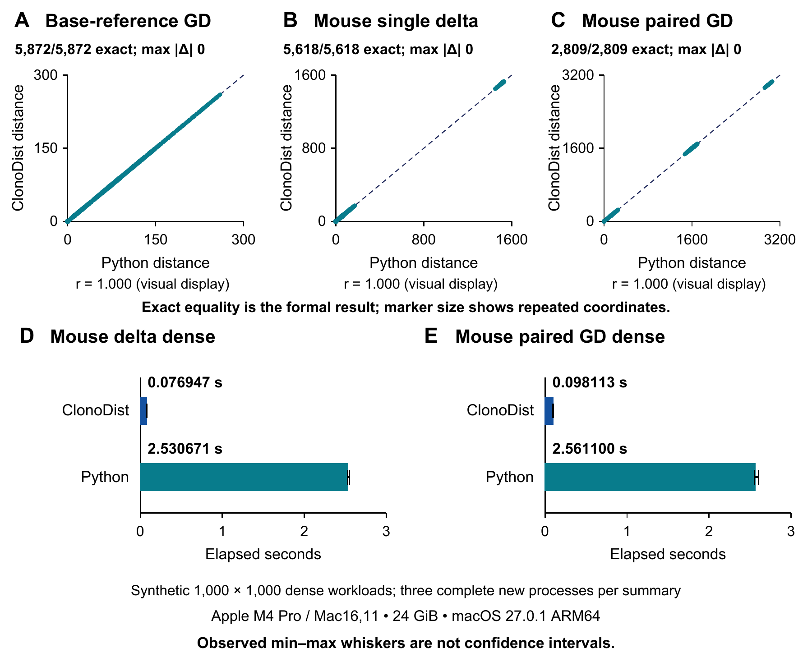

# ClonoDist

ClonoDist provides deterministic, reference-qualified T-cell receptor distance calculation and inspectable neighborhood analysis in Rust. It implements the established tcrdist3 and pwseqdist scoring method and does not introduce a new receptor-distance formula.

## Start here

- [Read the user manual](docs/USER_MANUAL.md)
- [Read the manuscript](docs/CLONODIST-MANUSCRIPT-v1.0.0.pdf)
- [Run the five-minute example](#five-minute-example)
- [Review the qualified scope and limitations](#qualified-scope-and-limitations)



**Figure 1. ClonoDist workflow.** ClonoDist adds explicit profiles, reference-qualified execution, deterministic outputs, and inspectable neighborhood analysis around an established receptor-distance method.

## What ClonoDist adds

- **Reference-qualified execution:** Inputs, profiles, and reference context are explicit.
- **Core and Extended workflows:** Defined modes cover single-chain, paired-chain, gamma/delta, and neighborhood workflows.
- **Deterministic outputs:** Scientific outputs retain their execution context within the tested settings.
- **Inspectable analysis:** Neighborhood decisions use explicit operational rules.

## Supported workflows

| Goal | Program |
|---|---|
| Single-chain alpha or beta distance | `clonodist` |
| Paired alpha/beta distance | `clonodist` |
| Profile-aware distance | `clonodist-extended` |
| Qualified gamma/delta workflows | `clonodist-extended` |
| Radius neighborhoods | `clonodist` |
| Operational discovery and matching | `clonodist-extended` |

## Installation

Install Rust, Cargo, and a C build toolchain. In the repository, run:

```bash
cargo build --workspace --locked
```

The first build needs network access when dependencies are not already cached. For beginner setup and platform-specific build tools, see the [user manual](docs/USER_MANUAL.md).

## Five-minute example

Run this example after building:

```bash
mkdir -p output

target/debug/clonodist distance \
  --synthetic-demo \
  --db examples/synthetic-reference.txt \
  --input examples/synthetic-receptors.tsv \
  --chains beta \
  --output output/readme
```

The records and reference are invented. This example tests software behavior only. The expected distance between the two invented records is 12. The output directory must be new. See the [user manual](docs/USER_MANUAL.md) for other workflows.

## Validation and local performance

The accepted qualification campaigns found exact agreement for the tested base-reference gamma/delta, mouse single-delta, and mouse paired gamma/delta workloads. Exact equality is the formal parity result; correlation is a visual display only.

The runtime results are descriptive local measurements, not cross-platform performance guarantees. The plotted dense workloads were synthetic. The recorded system was an Apple M4 Pro with 24 GiB memory, running ARM64 macOS. Whiskers show observed minimum-to-maximum values across three complete processes, not confidence intervals.

## Figure 2



**Figure 2. Exact computational parity and local performance.** Panels A–C show exact agreement with the Python reference results. Panels D–E show median elapsed time with observed minimum-to-maximum whiskers across three complete processes on the stated local system.

## Qualified scope and limitations

- Qualification applies only to the documented inputs, references, profiles, workflows, and environments.
- Human delta uses a dedicated-locus context. Mouse delta requires a supplemental reference, and mouse delta meta inference is outside scope.
- Alternative-profile biological interpretation remains experimental. Synthetic examples test software behavior only.
- Distance similarity does not prove shared antigen specificity. Operational matches do not establish sensitivity, specificity, HLA inference, causal biology, or clinical validity.
- Dense output can have quadratic cost. Managed memory planning is not a hard RSS limit.

See the [user manual](docs/USER_MANUAL.md) and [manuscript](docs/CLONODIST-MANUSCRIPT-v1.0.0.pdf) for the full scope.

## Documentation and publication

- [User manual](docs/USER_MANUAL.md)
- [Manuscript](docs/CLONODIST-MANUSCRIPT-v1.0.0.pdf)

## Third-party data boundary

Third-party records and governed reference datasets are not redistributed. Users must obtain required inputs from the original providers and follow their terms. See the [user manual](docs/USER_MANUAL.md) and [third-party notices](THIRD_PARTY_NOTICES.md) for preparation steps and attribution requirements. The [v1.0.0 reference record](https://github.com/Yoonecorn/ClonoDIst/blob/v1.0.0/README.md#third-party-data-boundary) preserves the detailed source versions and file identities.

## Citation

See [CITATION.cff](CITATION.cff) and the [manuscript](docs/CLONODIST-MANUSCRIPT-v1.0.0.pdf). Repository: https://github.com/Yoonecorn/ClonoDIst.

## License

Original software is licensed under [MIT](LICENSE). Original rights-cleared content uses [CC BY 4.0](CONTENT_LICENSE.md). Third-party materials retain their own terms.

## Contact

Yoon Sing Yap

yoonatworkz@gmail.com
